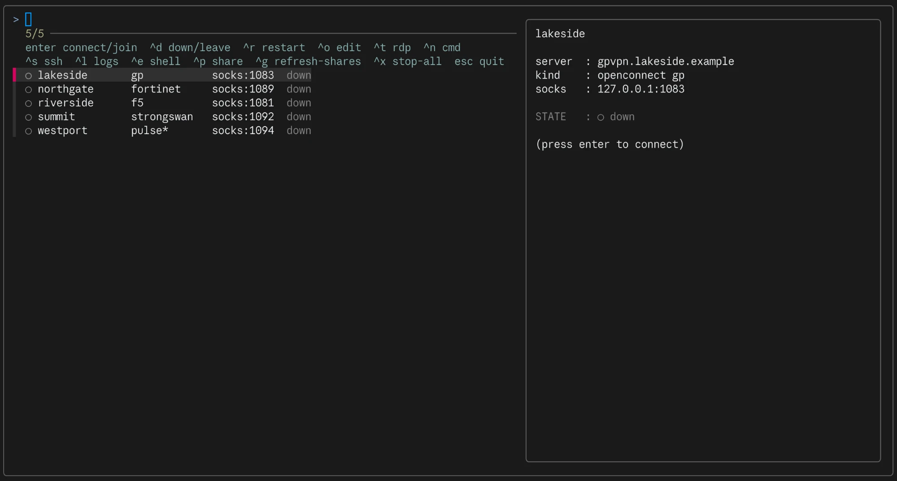

# tunnelyard

**The only VPN client on your PC is Docker.**

AnyConnect, GlobalProtect, Pulse, F5, FortiClient, OpenVPN, WireGuard,
strongSwan — none of them installed. Every customer VPN runs in its own
throwaway container, driven from a terminal UI.



Each tunnel runs in its own network namespace. Its tun device, routes and DNS
are invisible to the host, which means several customer VPNs can be up at the
same time without fighting over the default route — the thing that makes running
nine vendor clients on one Mac miserable. Nothing autostarts; a tunnel exists
only while its container runs.

You reach a customer network through a door you open deliberately on
`127.0.0.1`: a SOCKS5 proxy, and optionally fixed TCP forwards.

```
your PC                     │  container "vpn-riverside"  │  customer network
                            │  (own netns)                │
curl --socks5-hostname      │  microsocks :1080           │
  127.0.0.1:1081  ──────────┼──►  tun0 ──► openconnect ───┼──►  10.20.0.0/16
                            │  resolv.conf = their DNS    │
```

One client covers most gateways: `openconnect` speaks AnyConnect, GlobalProtect,
Pulse/Ivanti, F5, FortiGate, Juniper NC and Array; `openfortivpn`, `openvpn`,
`wireguard` and `strongSwan` cover the rest. Which one a customer uses is a line
in its config, not a different tool to learn.

## Setup

Needs Docker (OrbStack or Docker Desktop), plus `fzf` for the TUI.

**Platforms.** Developed and used daily on macOS. Linux should work — the
host-side paths (`xdg-open`, `xclip`/`wl-copy`, `--add-host` for
`host.docker.internal`) are all written, but untested, so treat Linux as
unverified and report what breaks. Windows would need WSL2 and is not
supported. Everything inside the tunnel is Linux regardless: that is where the
VPN client actually runs.

Then:

```bash
./bin/tunnelyard selftest
```

That builds the image and verifies the tun device, the SOCKS proxy and a TCP
forward end to end, without touching a real VPN. Put `bin/` on your PATH, or
symlink `bin/tunnelyard` into `~/.local/bin`.

## Start here: the TUI

```bash
tunnelyard tui
```

This is how you drive it day to day — the CLI below exists for scripting and for
the things a list can't express. Arrow through the customers; the pane on the
right shows the highlighted one's state, tunnel IP, routes and recent log, live.

| key | does | key | does |
|-----|------|-----|------|
| `enter` | connect (or join a shared tunnel) | `^o` | edit the config in `$EDITOR` |
| `^d` | disconnect / leave | `^n` | run one of its saved commands |
| `^r` | restart | `^s` | ssh through its proxy |
| `^t` | RDP in a browser | `^e` | shell inside the container |
| `^p` | share with a teammate | `^l` | logs |
| `^g` | refresh teammates' shares | `^x` | stop every tunnel |
| `f5` | refresh the list | `esc` | quit |

The dot and colour in the list are the health state, not merely whether a
container is running — see [below](#up-means-the-tunnel-carries-traffic). A `*`
after the protocol marks a config flagged `VPN_STATUS=pending`: known about, not
yet runnable.

### Behind the keys

```bash
tunnelyard tui
```

An fzf-driven manager: arrow through the customers (a live preview on the right
shows each one's state, tunnel IP, routes and recent log), and act on the
highlighted one:

```
enter  connect        ^o  edit config in $EDITOR     ^n  run/add a command
^d     disconnect     ^s  ssh through its proxy      ^x  stop all
^r     restart        ^l  logs                       f5  refresh
^t     rdp            ^e  shell in the container     esc quit
```

`^n` lists that customer's saved commands (`CMD_<label>=…` in its config) and
runs the chosen one **inside the tunnel container**, so a plain
`ssh user@10.x.x.x` reaches the internal host directly — no proxy needed. Pick
"add new" to define one on the spot; it's appended to the config. `tunnelyard run
<customer> <label>` does the same from the shell.

When `tmux` is installed, actions open in a **side pane** next to the list: press
enter and the connect (with its password / MFA prompts) runs on the right while
the list stays put, backgrounding itself once connected and refreshing the list.
If you start `tunnelyard tui` outside tmux it re-launches on a **dedicated** tmux server
(its own socket + config, so your own tmux setup is untouched) with mouse-copy
enabled — **drag to select in a pane and it copies to your system clipboard**
(double-click a word, triple-click a line). Set `VPN_TUI_PLAIN=1` for the old
full-screen behaviour (or if tmux isn't installed). `^o` opens that customer's
`.conf` in your `$EDITOR` (`tunnelyard edit
<customer>` does the same from the shell) — after editing, `^r` restarts the
tunnel to pick up the change.

`tunnelyard up` attaches you to the client console so you can answer password and MFA
prompts. Once connected, **ctrl-p ctrl-q** detaches and leaves the tunnel
running. Ctrl-c would stop it. `tunnelyard attach <customer>` gets you back to the
console if the client asks to re-authenticate.

## Adding a customer

> 📖 **[docs/CONFIGURING.md](docs/CONFIGURING.md)** is the full configuration
> reference — every setting explained, with a complete copy-paste example for
> each gateway type (AnyConnect, GlobalProtect, Ivanti/Pulse, FortiGate, F5,
> IPsec, OpenVPN, WireGuard), plus RDP, SSH, custom commands and 1Password.

Copy `customers/_template.conf` to `customers/<name>.conf`, set a unique
`SOCKS_PORT`, and pick the protocol matching the vendor client you are replacing:

| Vendor client | `VPN_KIND` / `VPN_PROTOCOL` |
|---|---|
| Cisco AnyConnect / Secure Client | `openconnect` / `anyconnect` |
| Palo Alto GlobalProtect | `openconnect` / `gp` |
| Ivanti Secure Access / Pulse | `openconnect` / `pulse` |
| F5 BIG-IP APM | `openconnect` / `f5` |
| FortiGate SSL VPN | `openconnect` / `fortinet` or `openfortivpn` |
| Juniper Network Connect | `openconnect` / `nc` |
| OpenVPN Connect | `openvpn` |
| WireGuard | `wireguard` |

The files already in `customers/` are pre-wired per vendor with non-colliding
ports — rename them to the actual customer and fill in `VPN_SERVER`.

`openvpn` and `wireguard` read their profile from `./config`, mounted read-only
at `/config`.

## Reaching things

**A browser or curl** — point at the SOCKS port:

```bash
curl --socks5-hostname 127.0.0.1:1081 https://intranet.customer.local
```

Use `--socks5-hostname`, not `--socks5`: that resolves DNS inside the container,
which is the only way internal names resolve. Firefox has the same switch
("Proxy DNS when using SOCKS v5") — one Firefox profile per customer works well.

**A fixed endpoint** — for an MLLP listener, SFTP box or database, skip SOCKS and
forward the port. In the customer's `.conf`:

```
FORWARDS=2575:10.20.5.40:2575,2222:10.20.5.41:22
```

Both ports are published on `127.0.0.1`, so anything on your machine talks to
`localhost:2575` as if it were on the customer LAN. No proxy configuration
anywhere. For most day-to-day work this beats SOCKS.

**SSH to internal hosts** — shortcuts live in the repo, not `~/.ssh/config`.
Copy `ssh/config.example` to `ssh/config`, add a `Host` block per server (its
`ProxyCommand` port is the customer's `SOCKS_PORT` from `tunnelyard list`), then:

```bash
tunnelyard up northgate          # bring the tunnel up
tunnelyard ssh northgate         # ssh through its proxy
```

`tunnelyard ssh` with no args lists the defined hosts. It runs `ssh -F ssh/config`, so
the blocks are self-contained (your `~/.ssh` keys still apply) and nothing leaks
into your global ssh config. `ssh/config` is gitignored (internal IPs and
usernames); the committed template is `ssh/config.example`.

**RDP to a Windows host — in a browser, no local client.** A separate container
renders the remote desktop into a plain browser tab (noVNC) and reaches the host
through the customer tunnel's SOCKS proxy, so no Microsoft Remote Desktop app is
needed:

```bash
tunnelyard up lakeside                       # tunnel up first
tunnelyard rdp lakeside 10.20.0.5 DOMAIN\\user
```

Set the target once in the customer config and you never retype it — then
`tunnelyard rdp <customer>` (or **`^t` in the TUI**) needs only the password:

```
RDP_SERVER=10.20.0.5
RDP_USER=DOMAIN\user
```

It prompts for the RDP password, starts an `rdp-<customer>` container, and opens
`http://127.0.0.1:<port>` (the web port is the customer's `SOCKS_PORT` + 5000,
e.g. 1083 → 6083). A `DOMAIN\user` argument is split into domain + user. `vpn
rdp-logs <customer>` tails the session, `tunnelyard rdp-stop <customer>` ends it
(`--all` for every session), and **`tunnelyard down <customer>` stops the RDP session
with the tunnel** (it rides the tunnel's proxy, so it can't outlive it).

```
browser ─http▶ 127.0.0.1:6083 ─▶ rdp-lakeside
                                  noVNC ◀ x11vnc ◀ Xvfb ◀ xfreerdp ─socks5▶
                                  host.docker.internal:1083 ─▶ vpn-lakeside ─▶ Windows host
```

Notes: prefer the server's **IP** for the target (name resolution depends on the
proxy). The RDP password is passed to the container as an env var, so it is
visible via `docker inspect` to a local user on this Mac — fine for a personal
machine, but don't run this on a shared host. The desktop is a fixed 1440×900
scaled to your browser window; the built image is `vpn-rdp` (kept separate so
the VPN base image stays small).

**Lockout-safe retries.** The password is fixed once the session starts, so a
wrong one is never re-submitted in a loop (which would trip the AD account
lockout). A failed connect retries **once** and then stops — set
`RDP_AUTH_RETRIES` to change it (0 = don't retry at all). A session that actually
established and only later dropped isn't counted, so a genuine tunnel hiccup
still reconnects.

**Another container** — put it in the tunnel's namespace and it reaches customer
hosts directly, no proxy config:

```yaml
services:
  app:
    network_mode: "container:vpn-riverside"
```

The catch: a container sharing another's namespace cannot publish ports of its
own, so its ports have to be declared on the VPN container instead.

## "up" means the tunnel carries traffic

A running container is not a working tunnel. When a gateway expires a session
server-side — an idle timeout is the usual reason — the client does not
necessarily notice: openconnect keeps its DTLS transport up, `tun0` keeps its
address, the routes stay installed, and every packet sent into the tunnel is
silently dropped. Judged on its own state the container looks perfect.

So `status`, `health` and the TUI do not ask the container how it is. They open
a TCP connection through the tunnel and watch the interface's receive counter:

| shown | means |
|---|---|
| `up` | the probe target answered — traffic is really flowing |
| `STALE (no return traffic)` | packets go in, nothing comes back; reconnect |
| `up (unverified)` | running, but no probe target is configured |
| `connecting` | container is up, the tunnel has no address yet |

A *refused* connection still counts as healthy: the RST is proof the tunnel
carries return traffic. Only silence, with the counter frozen, is a dead tunnel.

The probe target is `HEALTH_PROBE=host:port`, defaulting to the first `FORWARDS`
entry, so most customers need no configuration. Results are cached for 15s
(`VPN_HEALTH_TTL`); `tunnelyard health` and the TUI's preview pane always probe fresh.

## Staying connected

Gateways measure *user* traffic, not the client's protocol keepalives, so a
tunnel you leave alone gets reaped. Set `KEEPALIVE_INTERVAL` (seconds, and
comfortably under the gateway's timeout — it logs `Idle timeout is N minutes` at
connect) to send real traffic through the tunnel on an interval:

```
KEEPALIVE_INTERVAL=240
KEEPALIVE_TARGET=          # defaults to the HEALTH_PROBE / FORWARDS target
```

It is off by default: an always-alive session may be at odds with the customer's
own security policy, so it is opted into per customer.

Some gateways ignore tunnel traffic entirely and expire the session on **HTTP**
inactivity instead — Riverside does. For F5 scripted logins, `F5_SESSION_KEEPALIVE`
(seconds) refreshes the APM session itself over HTTPS with the session cookie,
and logs whether the session is still valid on every poll. That log line is what
makes a stale tunnel attributable; see "Diagnosing a stale tunnel" in
[docs/CONFIGURING.md](docs/CONFIGURING.md).

## Credentials from 1Password

Connect without typing anything. One-time setup: in the 1Password desktop app,
**Settings → Developer → turn on "Integrate with 1Password CLI"** (so `op` can
use your accounts with Touch ID). Then point a customer at its item:

```
OP_ITEM=op://Private/Northgate VPN
OP_OTP=1
```

On `tunnelyard up <customer>`, `op` runs on your machine (Touch ID / system auth) and the values are typed
straight into the client at its prompts — password, then the TOTP if `OP_OTP=1`:

- the item's **username** fills `VPN_USER` when that's blank;
- the **password** is typed at the password prompt;
- the **one-time password** is typed at the 2FA prompt.

The secrets go from `op` into the VPN client and never touch the container's
environment or `docker inspect`. If a gateway's 2FA prompt isn't recognised, set
`VPN_OP_TOKEN_RE` to a regex matching it. Covers openconnect-based customers
(GlobalProtect, Pulse/Ivanti, FortiGate SSL, AnyConnect, F5); the F5 *scripted*
login and SMS/email codes still prompt.

## Sharing a tunnel with a teammate

A connected tunnel is just a SOCKS proxy on `127.0.0.1`, so you can let a teammate
use it without a second gateway login. `tunnelyard share` reverse-forwards the proxy up
to a **jump host you both can reach** — nothing central relays the data beyond
that host, and the customer gateway isn't touched again.

One-time: copy `share.conf.example` to `share.conf` and set the jump host:

```
SHARE_JUMP=you@jump.example.com
SHARE_SSH=tsh ssh          # or plain `ssh`
```

Then:

```bash
tunnelyard up riverside
tunnelyard share riverside           # or ^p in the TUI
```

`tunnelyard shares` lists what you're sharing; `tunnelyard unshare riverside` stops one; and it
stops automatically with `tunnelyard down`.

### Only the person you want

By default a share is **password-protected**: `tunnelyard share` puts an authenticated
SOCKS5 proxy in front of the tunnel and prints a freshly generated password. Only
the person you hand it to can use the forward — even though it lands on a jump
host others can reach. You give the socks user (`share`) and the password to that
one person out of band; the password is **never** written to the jump host.

```
Hand these to the ONE person you want -- nobody else can use the share:
  socks user : share
  password   : I9x2bgWMuCh1qEd5u4T52w
```

The auth proxy is a small Mac-side helper ([libexec/authproxy.py](libexec/authproxy.py),
Python stdlib) that chains to the tunnel's own proxy, so nothing in the container
changes and a running tunnel needs no restart. Set `SHARE_AUTH=0` in `share.conf`
to forward the proxy directly with no password — only sensible when the jump host
itself is already restricted (by Teleport RBAC) to exactly the people you intend.

### Joining from the other side

If your teammate also has this repo and the **same** `share.conf` jump host, they
don't copy-paste anything — the share advertises itself on the jump host:

```bash
tunnelyard available              # list tunnels teammates are sharing (AUTH = pass/open)
tunnelyard join riverside            # opens a local SOCKS5 proxy on 127.0.0.1:<port>
tunnelyard joined                 # list what you've joined
tunnelyard leave riverside           # disconnect
```

For a password-protected share, `tunnelyard join` asks for the password the sharer gave
you and then prints a ready-to-paste `curl -x socks5h://share:<pass>@127.0.0.1:<port>`.
In the **TUI**, joinable shares appear in their own _“shared by teammates”_
section: press **enter** to join (it prompts for the password if needed), **^d**
to leave, **^g** to refresh the list. (The section only shows in the tmux TUI, and
the list is cached so a slow or offline jump host never stalls it.)

Without the repo, a teammate can still join by hand — `tunnelyard share` also prints the
raw `ssh -L …` line and the port to use.

> **This shares a live session** — everything the joiner does is attributed to
> your authenticated session and IP. Only do it for a customer you're both cleared
> for. Bind the jump-host port to its `127.0.0.1` (the default) so only people who
> can already ssh into it can reach the forward.

## Command reference

The TUI covers all of this. These are for scripts, and for when you already know
the customer's name and just want the thing to happen.

```bash
tunnelyard tui                    # the interactive manager (start here)
tunnelyard list                   # configured customers and their ports
tunnelyard up riverside           # connect (prompts for password / MFA)
tunnelyard down riverside         # ...or --all
tunnelyard restart riverside      # stop and reconnect
tunnelyard status                 # what is up right now, health-checked
tunnelyard watch                  # live-updating status table
tunnelyard health [riverside]     # probe the data path; non-zero unless really up
tunnelyard info riverside         # live details: tunnel IP, routes, recent log
tunnelyard logs riverside [-f]    # client output
tunnelyard edit riverside         # open its config in $EDITOR
tunnelyard attach riverside       # back to the client console (re-auth prompts)
tunnelyard shell riverside        # a shell inside the tunnel's namespace
```

```bash
tunnelyard ssh <host>             # ssh via a customer's proxy (see ssh/config)
tunnelyard run <cust> <label>     # run a saved CMD_<label> for that customer
tunnelyard rdp <cust> [host user] # RDP to a Windows host, in a browser
tunnelyard share <cust>           # share a live tunnel with a teammate
tunnelyard available              # tunnels teammates are sharing
tunnelyard join <cust>            # use one of them
tunnelyard selftest               # verify the plumbing without a real VPN
```

`VPN_CUSTOMERS` points at a different directory of configs. `docs/demo-customers/`
holds the invented set used for the screenshots above, which is handy for trying
things out without touching your real customers:

```bash
VPN_CUSTOMERS=docs/demo-customers tunnelyard tui
```

## Riverside (F5 APM portal)

The logon form asks for username, password and a strong-auth method (SMS or
EMAIL), then a one-time code sent by that channel. **openconnect cannot drive
it** — its F5 parser ignores `<input type=radio>` (it logs `Ignoring unknown
form input type 'radio'`), so it never submits the method and the policy
dead-ends at `/vdesk/hangup.php3` right after the password. `--form-entry`
cannot help, because openconnect drops the field entirely rather than leaving it
blank.

So the container completes the logon with `curl` instead. `VPN_F5_SCRIPTED=1`
(already set in `customers/riverside.conf`) runs `f5-login`, which posts
username + password + `otp=EMAIL`, prompts for the emailed code, and hands the
resulting authorized session to openconnect to build the tunnel:

```bash
tunnelyard up riverside
```

You type two things: your password (hidden) and the emailed code. No browser, no
devtools, no cookie copying. `VPN_F5_OTP=SMS` switches the channel to SMS.

**Caveat — Endpoint Inspection.** In the browser flow the portal runs Endpoint
Inspector after login. The scripted logon skips it. This works only if Riverside's
policy does not make inspection a *hard* requirement for the tunnel grant. The
earlier manual cookie hand-off showed the tunnel comes up with no inspector
running in the container, which is encouraging — but a browser had run the
inspector first in that case. If the scripted session authenticates and then
gets no tunnel (openconnect's `GET /vdesk/vpn/index.php3` bounces back to the
logon page), inspection is mandatory and you fall back to:

- **Cookie hand-off** — set `VPN_F5_SCRIPTED=0` and `VPN_COOKIE=1`, log in via
  the browser, wait for Endpoint Inspector to finish and the portal to open,
  then devtools → Network → any request to the portal host → Cookies →
  copy `MRHSession`, and paste it at `tunnelyard up riverside`. (It is not authorized for
  network access until inspection completes, so do not copy it early.)
- **macOS VM** — if the policy re-inspects periodically and kills a handed-off
  session after minutes, run the vendor client in a VM (see below).

Either way the tunnel lives in the container, F5 VPN.app never runs on the host,
and the DNSProxy system extension stays unapproved.

### Inspecting the login without connecting

`f5-login` has offline hooks, handy if the form ever changes:

```bash
# what fields does the logon page expose?
docker run --rm --entrypoint f5-login vpn-base:latest parse /dev/stdin < saved.html
```

`tunnelyard probe riverside` fetches the live logon page (unauthenticated) and lists its
form fields.

## FortiClient IPsec (strongSwan)

Some FortiClient tunnels are **SSL VPN** (`VpnType 0` in FortiClient) and some
are **IPsec** (`VpnType 1`, IKEv1 aggressive + XAuth). openconnect does the SSL
ones (`VPN_PROTOCOL=fortinet`); the IPsec ones can't be done by openconnect at
all and run through strongSwan instead (`VPN_KIND=strongswan`).

The parameters were recovered from FortiClient's `vpn.plist`; a customer config
carries the gateway, the IKE group (local ID), the XAuth identity, and the
phase-1/phase-2 proposals. Because aggressive mode carries a single DH group in
its first message, every IKE proposal shares one `modp` group.

Two secrets are needed, and neither is stored in the repo:

- **Group pre-shared key** — the shared group secret (same for everyone on that
  IKE group). FortiClient keeps it encrypted with a hardcoded key; recovering it
  from the client is non-trivial, so get it from the customer or your own vault.
  Provide it either as a gitignored file `config/secrets/<name>.psk` (or
  `<group>.psk`), or let the container prompt for it at connect.
- **XAuth password** — your personal password; always prompted, never stored.

```bash
tunnelyard up summit
```

If negotiation fails, `tunnelyard logs summit` shows charon's output; the usual
culprits are a wrong PSK/XAuth password or a proposal mismatch
(`VPN_IKE_PROPOSAL` / `VPN_ESP_PROPOSAL`). If the container's kernel refuses to
install ESP state, switch to userland IPsec by loading the `kernel-libipsec`
plugin (both plugins are in the image).

## Where this does not work

`openconnect` authenticates; it cannot pretend to be a compliance agent. Gateways
that enforce endpoint posture will authenticate you and then refuse the tunnel:

- **Cisco ISE posture** — you have `com.cisco.anyconnect.aciseposture` loaded
- **GlobalProtect HIP checks**
- **FortiClient ZTNA**
- **F5 Endpoint Inspection**, unless the cookie hand-off above holds

Two vendors have no open client at all:

- **Check Point Endpoint Security VPN** — no `openconnect` support
- **Sophos Connect** — IPsec/strongSwan; the `strongswan` `VPN_KIND` (see
  "FortiClient IPsec" below) could be adapted to it, but it is not wired up

For those, run the vendor client in a macOS VM (VirtualBuddy or UTM), enable
Remote Login in the guest, and expose it the same way as everything else:

```bash
ssh -D 1090 -N you@customer-vm.local
```

Now that customer is a SOCKS proxy on `127.0.0.1:1090` too, and whether it is a
container or a VM stops mattering.

## On the host itself

The point is that none of these get installed on the host. Where a customer
contractually requires the vendor client on the physical machine, keep it off
the boot path:

- System Settings → General → Login Items & Extensions → turn off everything
  under "Allow in the Background" for that vendor
- `sudo launchctl bootout system/<label>` then `sudo launchctl disable system/<label>`
- decline the network system extension prompt unless the client genuinely needs
  it — that is what keeps FortiClient and F5 out of your DNS path

A leased machine may have MDM pushing some of this back regardless.

## Troubleshooting

**Was working, now nothing.** Run `tunnelyard health <customer>`. `STALE` means the
gateway expired the session while the client held its transport open — `vpn
restart <customer>`, and set `KEEPALIVE_INTERVAL` so it stops happening.

**Authenticates then hangs, no traffic.** `vpnc-script` did not install routes.
`tunnelyard shell <customer>` and check `ip route` and `/etc/resolv.conf`.

**Internal names do not resolve.** You used `--socks5` instead of
`--socks5-hostname`, or the client's proxy DNS toggle is off.

**SAML / browser login.** Set `VPN_EXTRA=--external-browser=/usr/bin/xdg-open`
and follow the URL openconnect prints.

**UDP blocked / unstable.** Add `--no-dtls` to `VPN_EXTRA`.

**Certificate rejected.** openconnect prints a `pin-sha256:` value on first
connect; put it in `VPN_SERVERCERT`.

---

## License

MIT — see [LICENSE](LICENSE).
